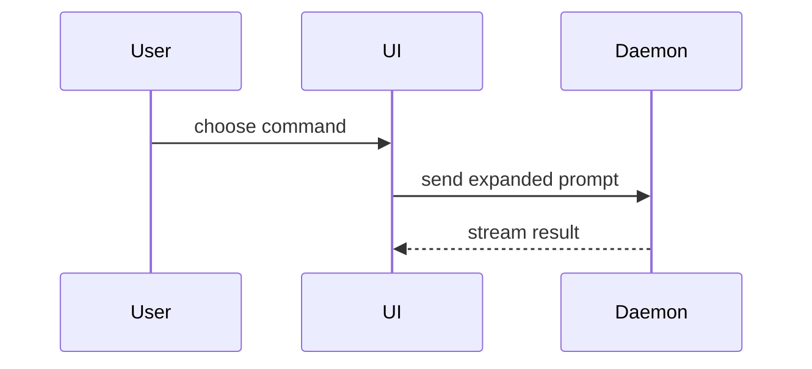

# Publish the pull request

Invoking this skill authorizes publishing the current reviewed branch: verify
the delta, push the branch, create its pull request through GitHub CLI, and
monitor its checks. It does not authorize merging.

## Preflight

1. Fetch the remote, then resolve the requested base branch (default `main`),
   current branch, merge base, commits, and changed files.
2. Require a named feature branch and clean working tree. Stop on a detached
   HEAD, the base branch itself, unresolved conflicts, unrelated changes, or a
   delta that does not match the completed ticket.
3. Run `gh --version` and `gh auth status` for the remote host. If `gh` is
   unavailable, stop and provide `winget install --id GitHub.cli`. If it is not
   authenticated, stop and provide `gh auth login`. Do not fall back to making
   the user copy a body into GitHub manually.
4. Query for an existing PR for the branch. If one exists, report its URL and
   checks without creating or rewriting it unless the user requested an update.

Preflight is complete when the exact intended delta is known and GitHub CLI can
publish it.

## PR body

Use this template for writing the PR body:

```markdown
## Summary

<diagram, diff-sketch, or tree>

## Evidence

- **Before:** <screenshot/output/failing test run>
  **After:** <screenshot/output/passing test run>

## Merge Danger

**Door:** <one-way or two-way>

<optional: description>

**Blast Radius:** <one-word description>

<optional: potential ramifications of merge>
```

## Sections

Skip all preambles and keep prose brief. Use the user's domain language from `GLOSSARY.md`.

### Summary

Pick the smallest view that makes the key point clear.

- Show logic or an algorithm as pseudocode:

```text
on(save)
  if content is unchanged
    return cached result
  write new content
  return fresh result
```

- Show runtime control flow as a call tree:

```text
submitForm
  createSession
    persistPrompt
    launchAgent
  navigateToSession
```

- Show UI structure as a component tree, including state and module boundaries that matter:

```text
<SessionPage> (apps/example/src/routes/session.tsx)
  useSessionEvents()
  <SessionToolbar>
    <RunSkillButton> (packages/ui)
```

- Show file responsibility or a broad refactor as a shallow file tree:

```text
src/
├── commands/       # parses user actions
├── sessions/       # owns session state
└── transport/      # sends API requests
```

- Show component interaction, control flow, or data flow with Mermaid:



- Use `diff` when the point is what changes and the surrounding shape already exists. Match the diff shape to the topic.

For a component change:

```diff
 <SessionPage>
   useSessionEvents()
   <SessionToolbar>
+    <RunSkillButton />
   <SessionTimeline>
+    <SkillResultCard />
```

For a file-layout change:

```diff
 src/
 ├── commands/
+│   └── show-me.ts       # expands the slash command
 ├── sessions/
-└── transport.ts
+└── transport/
+    ├── client.ts
+    └── stream.ts
```

For a call-tree or call-stack change:

```diff
 submitForm
   createSession
     persistPrompt
+    expandSkillMention
     launchAgent
-  navigateToSession
+  navigateToSession
+    subscribeToEvents
```

For a state or control-flow change:

```diff
 on(save)
-  write content
+  if content is unchanged
+    return cached result
+  write new content
+  invalidate cache
```

- Show the whole block when most of it is new, when omitted context would hide ownership or order, or when the user needs a copyable target shape:

```ts
function expandSkill(command: string): string {
  const skillName = command.slice(1);
  return `use the ${skillName} skill`;
}
```

#### Guidance

Place each visual next to the short text it supports. Keep only the calls, files, props, states, and boundaries needed to answer the user's current question or the options to resolve the current discussion point.

You may use one of these, you may use several, it is unlikely you will use all of them. Use your judgement and don't overwhelm the user.

### Evidence

Concrete evidence that the change works. Show a before and after.

Screenshots are S-tier - when the environment is set up for it and the change is visual.

Execution-based evidence is A-tier. Test results, console output. Show the exact test that now fails and passes, using pseudocode.

### Merge Danger

Describe whether it's a one-way or two-way door. You can walk back through two-way doors, but not one-way doors. A PR that is cheap to roll back is lower risk. Changes that involve destructive actions or hard-to-reverse decisions are one-way doors.

The blast radius is the potential impact or scope of the changes introduced by this PR. Consider all possibilities. Examples are layout shift, breakages for consumers, mobile responsiveness, etc.

## Push, create, and monitor

1. Push the current branch with upstream tracking.
2. Write the generated body to a temporary file so shell quoting cannot alter
   its Markdown.
3. Create the PR non-interactively:

   ```text
   gh pr create --base <base> --head <branch> --title <title> --body-file <file>
   ```

4. Resolve and report the created PR with:

   ```text
   gh pr view --json number,url,title,baseRefName,headRefName
   ```

5. Monitor checks with `gh pr checks --watch`. Report failures without changing
   code outside the originating ticket.
6. Remove only the temporary body file created by this run.

Completion means the branch is pushed, the PR exists, its URL and check result
are reported, and the working tree remains clean. Leave the PR unmerged.
